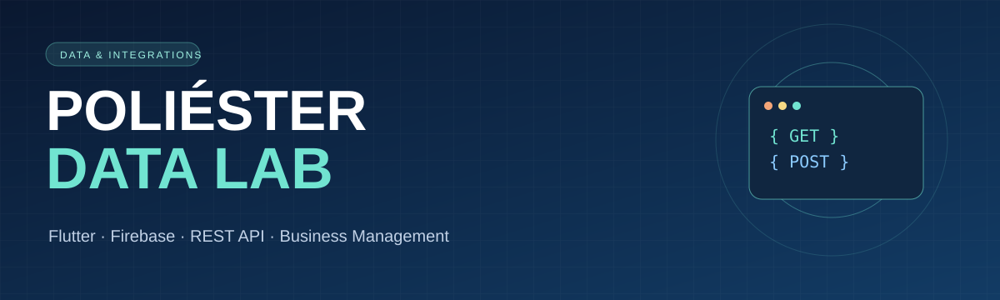

<div align="center">


<br/>


**Aplicación académica de gestión comercial, persistencia de datos e integraciones HTTP.**

[Demo web interactiva (GitHub Pages)](https://juanjogamero.github.io/gestor_poliester/) · [Código de la demo](docs/index.html) · [Depofibra](https://depofibra.com/)
</div>

---

## Sobre el proyecto

**Poliéster DataLab** es un proyecto de la asignatura **Acceso a Datos**, desarrollado en Flutter para explorar una solución de gestión comercial basada en **Firebase Authentication, Cloud Firestore y servicios REST externos**.

El código Flutter incluye autenticación con Google, CRUD de productos, clientes y pedidos, consultas reactivas en Firestore y un módulo de integración HTTP que utiliza JSONPlaceholder para practicar peticiones GET y POST.

> [!IMPORTANT]
> **Versión académica y demo de portfolio.** No es un ERP en producción ni un sistema de gestión autorizado para usar datos reales. El servicio JSONPlaceholder es de pruebas: recibir un HTTP 201 no equivale a sincronizar pedidos con un ERP. Para el portfolio se incluye una **demo web estática independiente**, sin Firebase ni tráfico externo, con datos ficticios guardados localmente.

## Explorar en el navegador

La [demo web](https://juanjogamero.github.io/gestor_poliester/) permite probar la interfaz sin instalar Flutter ni configurar Google Sign-In:

| Módulo | Qué se puede hacer |
| --- | --- |
| **Dashboard** | Consultar métricas de ejemplo, actividad y estados de pedidos |
| **Clientes** | Crear, buscar, editar y eliminar registros ficticios |
| **Productos** | Gestionar el catálogo, precios, categorías y capacidades |
| **Pedidos** | Registrar pedidos, vincular cliente/producto y actualizar estados |
| **API & Integraciones** | Ejecutar ejemplos simulados de GET y POST y examinar las respuestas JSON |

Los registros se conservan en `localStorage` dentro del navegador y pueden reiniciarse. **No introduzcas datos empresariales reales ni información personal**.

## Tecnologías del proyecto original

| Tecnología | Responsabilidad |
| --- | --- |
| Flutter y Dart | Interfaz multiplataforma |
| Firebase Authentication | Inicio de sesión con Google |
| Cloud Firestore | Lecturas reactivas y almacenamiento CRUD |
| `http` | Peticiones de prueba a JSONPlaceholder |
| `intl` | Formatos de fecha |
| `flutter_test` | Pruebas de serialización de entidades |

## Arquitectura

```text
lib/
├── main.dart                 # Arranque y flujo de autenticación
├── models/
│   ├── cliente_model.dart
│   ├── producto_model.dart
│   └── pedido_model.dart
├── screens/
│   ├── login_screen.dart
│   ├── home_screen.dart
│   ├── clientes_screen.dart
│   ├── productos_screen.dart
│   └── pedidos_screen.dart
└── services/
    ├── auth_service.dart     # Google Sign-In / Firebase Auth
    ├── firestore_service.dart# Lectura y escritura en Firestore
    └── api_service.dart      # Integraciones GET / POST de demostración

docs/
├── banner.svg                # Identidad visual del portfolio
└── index.html                # Demo estática independiente

test/
└── widget_test.dart          # Pruebas de modelos
.github/workflows/
└── pages.yml                 # Publicación de la demo
```

## Ejecución local

**Demo estática (sin dependencias):**

```bash
python -m http.server 8000 --directory docs
```

Abre `http://localhost:8000`.

**Aplicación Flutter:**

```bash
git clone https://github.com/juanjogamero/gestor_poliester.git
cd gestor_poliester
flutter pub get
flutter analyze
flutter test
flutter run
```

La app Flutter necesita un **proyecto Firebase propio** correctamente configurado para la plataforma de destino y un proveedor Google Sign-In habilitado. No se ha validado la compilación ni la integración con Firebase en un entorno de ejecución durante esta revisión.

## Publicación en GitHub Pages

La demo se sirve desde `docs/` con el workflow `.github/workflows/pages.yml`.

1. Abre **Settings → Pages** del repositorio.
2. Establece **Source: GitHub Actions**.
3. Abre **Actions → Deploy DataLab demo to GitHub Pages** y ejecuta el workflow en `main`.
4. Comprueba que el despliegue finaliza correctamente antes de compartir la URL.

Si decides cambiar el nombre del repositorio a **`poliester-data-lab`**, actualiza el enlace de Pages a `https://juanjogamero.github.io/poliester-data-lab/` y el de clonación al nuevo nombre. GitHub no publica automáticamente el sitio solo por existir este workflow.

## Aspectos a reforzar antes de un uso real

- Reglas de acceso y autorización detalladas en Firestore.
- Confirmaciones de borrado, validaciones, estados de error y pruebas de integración.
- Separación de entornos, gestión de credenciales y observabilidad.
- Integraciones empresariales con endpoints auténticos, autenticación y manejo explícito de errores.
- No enviar datos de clientes o pedidos a servicios públicos de prueba.

---

<div align="center">
<b>Juan José Gamero López</b> · <a href="https://github.com/juanjogamero">GitHub</a><br>
<sub>Proyecto académico · Acceso a Datos · Flutter, Firebase y API REST</sub>
</div>
